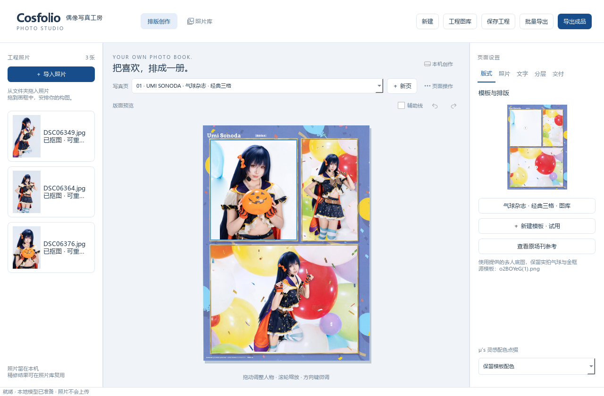
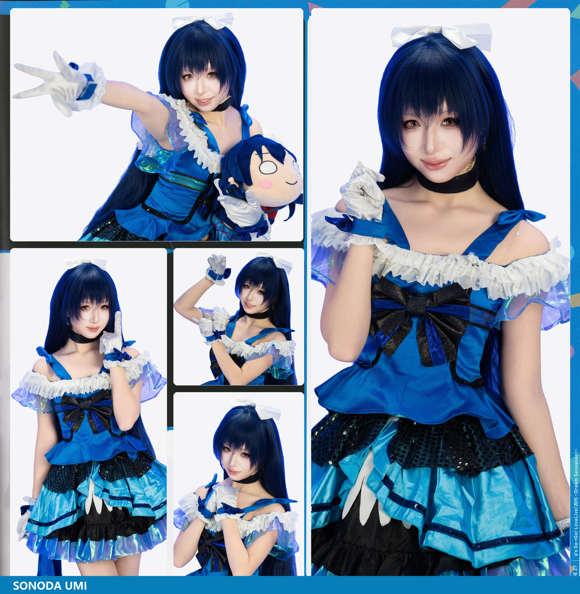
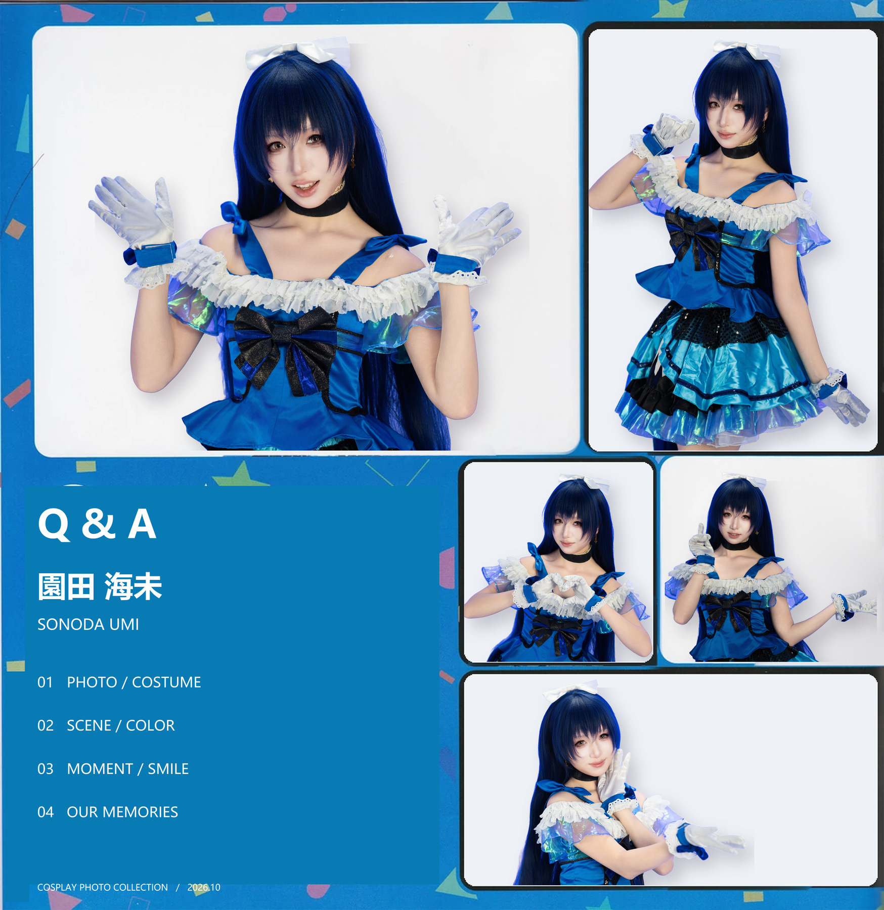

# Cosfolio · 偶像写真工房

**把自己的 Cos 正片，放进喜欢的场刊里。**

给拉拉人、摄影和 Coser 的 Windows 本地写真排版工具。照片在本机抠图、精修和排版，不上传云端，不用于模型训练；人物来自真实照片，不由生成式 AI 重绘。

**[下载 Windows 完整包](https://github.com/hazemimo/Cosfolio/releases/download/v0.9.0-beta.1/Cosfolio-v0.9.0-beta.1-Windows-x64.zip)** · [全部版本](https://github.com/hazemimo/Cosfolio/releases) · [使用说明](docs/使用说明.md) · [反馈问题](https://github.com/hazemimo/Cosfolio/issues)

当前公开测试版：**0.9.0-beta.1**。

## 下载后怎么用

1. 在 Releases 中下载 `Cosfolio-v0.9.0-beta.1-Windows-x64.zip`。
2. 完整解压到自己有写入权限的文件夹，双击 `Cosfolio.exe`。请保留整个程序目录。
3. 导入照片，选择模板，把照片拖入画框，调整构图后导出。

完整包已经包含运行环境与本地 BiRefNet 模型，**无需安装 Python、无需 API Key，日常使用无需联网**。GitHub 自动生成的 `Source code (zip)` 是源码，不是可直接双击运行的程序。

已在 Windows 11 x64 验证；Windows 10 x64 的兼容情况欢迎反馈。公开测试版尚未提供 macOS、Linux 或手机版，也未提供数字签名。

## 可以做什么

- **本地处理**：自动识别照片主体，保留原片，蒙版与原照片分开管理。
- **场刊排版**：可视化模板图库，原场刊参考，拖放选片，自由调整人物大小和位置。
- **细节精修**：滚轮放大，擦除多余背景、恢复误删部分，Ctrl+Z 撤销；Alt+拖动平移画面。
- **本地新建模板**：导入自己的场刊扫描页或底图，标记照片区域，自动识别后手动修正蒙版和背景。复杂背景不保证自动补全。
- **照片管理**：专辑、标签、收藏、蒙版版本、归档恢复、精修素材复用和双图选片。
- **成品交付**：多页工程、默认最长边 6000、最高 8000 像素，透明 PNG 和编号联系表。

当前发行版包含 22 款模板。官方场刊参考及其衍生底图属于第三方素材，详见 [素材权利说明](ASSET_RIGHTS.md)。本项目并非 LoveLive! 官方软件。

## 成品示例

  
  

示例摄影：**Haze**；模特：**笑笑**。照片为提供者已有成品，用于说明排版方向，不表示全部步骤均由软件一键完成。

## 隐私与资料

应用不会调用在线图像 AI，不上传照片，不以照片训练模型。运行时的工程、原片副本、蒙版和照片库保存在程序目录的 `workspace/` 中，请自行备份。用户主动向 GitHub 上传截图或问题附件，是用户自行选择的公开行为。

升级前请备份工程和照片库。旧 `.cosfolio` 工程可以打开；照片库可通过 `.cosphotos` 归档包迁移。不要只复制照片库数据库而遗漏对应文件。

## 源码、许可与贡献

应用代码采用 **PolyForm Noncommercial License 1.0.0**：源码公开，非商业用途可以按许可使用、修改和分享。**商业用途需要另外授权，包括收费约拍或商业写真处理。** 详情见 [LICENSE](LICENSE) 和 [许可范围](LICENSE-SCOPE.md)。第三方软件、模型及图片保留各自许可和权利。

开发运行与打包步骤见 [BUILDING.md](BUILDING.md)。欢迎通过 Issues 反馈，或提交符合项目许可的修改。请勿提交私人原片、用户工程、照片库、密钥或未经许可的新增素材。

维护者：**Haze / [hazemimo](https://github.com/hazemimo)**。
